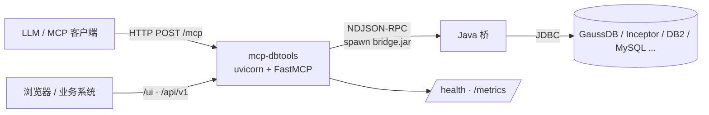

# mcp-dbtools

> **v1.5.0** · 数据库 MCP 服务：**MCP 工具 + REST API + Web 控制台** · [更新日志](CHANGELOG.md)

通过 JDBC 把 GaussDB / openGauss、TDH Inceptor、Hive、DB2、MySQL、PostgreSQL 等数据库
开放给 LLM 客户端（MCP），同时提供 REST API 与 Web 控制台供人使用、供系统对接。
JDBC 访问由 **open-dbclient Java 桥子进程**（NDJSON-RPC，`bridge.jar`）完成，Python 侧不内嵌 JVM。

**文档导航**

| 文档 | 内容 |
| --- | --- |
| [docs/架构设计.md](docs/架构设计.md) | 分层、local/remote 拓扑、路由总表、API 分组与错误码、迁移对照 |
| [docs/使用说明.md](docs/使用说明.md) | 部署、配置、工具、监控、排错（运维手册） |
| [docs/二次开发指南.md](docs/二次开发指南.md) | 内网离线环境改源码、跑测试 |
| [docs/技术选型-nodejs-vs-python.md](docs/技术选型-nodejs-vs-python.md) | 为什么是 Python（含迁移路线） |

## 功能特性

- **多数据源**：JDBC 能力探测自动适配，无方言硬编码；新增数据库只加配置与驱动 jar
- **双形态交付**：MCP（`/mcp`）+ REST（`/api/v1`）+ Web（`/ui`）共用同一服务层
- **安全**：Bearer 鉴权 · 写操作 `confirm` 二次确认 · 密码 `{ENC:...}` 加密 · 熔断 · 按 IP 限流 · 行数上限
- **可观测**：审计（JSONL 轮转 + SQLite）· `/metrics` · 执行历史 · Web 控制台
- **可发现**：MCP 能力自描述（`/api/v1/mcp/tools` 返回参数 schema，`/ui/tools` 可浏览）
- **运维友好**：内网离线包 · systemd/pm2 · 共享桥 · 异步大数据导出 · 显式事务

## 支持的数据库

| 数据源 | 驱动类 | JDBC URL 示例 |
| --- | --- | --- |
| GaussDB / openGauss | `org.opengauss.Driver` | `jdbc:opengauss://host:5432/db` |
| TDH Inceptor（星环） | `org.apache.hive.jdbc.HiveDriver` | `jdbc:hive2://host:10000/default` |
| 其他 Hive 兼容 | `org.apache.hive.jdbc.HiveDriver` | `jdbc:hive2://...` |
| PostgreSQL 兼容 | `org.postgresql.Driver` | `jdbc:postgresql://...` |
| DB2 | `com.ibm.db2.jcc.DB2Driver` | `jdbc:db2://host:50000/db` |
| MySQL / MariaDB | `com.mysql.cj.jdbc.Driver` | `jdbc:mysql://host:3306/db?useUnicode=true&characterEncoding=UTF-8` |
| SQLite（演示/测试） | `org.sqlite.JDBC` | `jdbc:sqlite:data/demo.db` |

> DB2 驱动受 IBM 许可限制不能自动下载，需手工放入 `drivers/`；`type: db2` 只影响健康探测的 ping 语句。
> SQLite 用于本地演示：`python scripts/create_sqlite_demo.py` 生成 `data/demo.db`，无需安装数据库即可跑通全链路。

## 架构



- 传输层（`api/` `web/` MCP）只做协议适配，业务在 `jdbc.py` / `monitor.py` / `export.py` / `services/`
- **本地**形态可用 stdio 或 localhost；**远程**形态强制 Token，可接共享桥
- 桥的两种接法：随服务 spawn（默认），或连共享桥 `MCP_DBTOOLS_BRIDGE_URL`（多实例共用 JVM）

### HTTP 端点

| 分组 | 端点 | 鉴权 | 说明 |
| --- | --- | --- | --- |
| MCP | `POST /mcp` | ✅ | LLM 客户端调用工具 |
| 运维 | `GET /health` | ❌ | 健康检查，`?deep=1` 逐个数据源真实探测 |
| 运维 | `GET /metrics` | ✅ | 指标 JSON（数据源/内存/工具/缓存/事务） |
| Web | `GET /ui/` | ❌ 外壳 | 控制台；数据走 `/api/v1`，需 Token |
| system | `GET /api/v1/system/*` | ✅ | 元信息 / 健康 / 指标 / 脱敏配置 |
| mcp | `GET /api/v1/mcp/*` | ✅ | 工具清单与参数 schema（自描述） |
| datasources | `/api/v1/datasources*` | ✅ | 数据源增删改查与连通性测试 |
| query | `POST /api/v1/query/execute` | ✅ | 执行 SQL（写操作需 `confirm=true`） |
| metadata | `GET /api/v1/metadata/*` | ✅ | 库 / 表 / 字段浏览 |
| exports | `/api/v1/exports*` | ✅ | 导出任务与文件下载 |
| audit | `GET /api/v1/audit/*` | ✅ | 审计记录 / 详情 / 汇总 |
| logs | `GET /api/v1/logs` | ✅ | 服务日志尾部 |

统一响应包：成功 `{"ok": true, "data": ...}`，失败 `{"ok": false, "error": {"code", "message"}}`。
分组细则与错误码见 [架构设计](docs/架构设计.md#6-rest-api-规范)。

## 目录结构

```
mcp-dbtools/
├── src/mcp_dbtools/
│   ├── server.py        # CLI 入口（参数 / 日志 / transport）
│   ├── app.py           # ASGI 装配（MCP + /api/v1 + /ui + 中间件）
│   ├── api/             # REST 分组：system mcp datasources query metadata exports audit logs
│   ├── web/             # Web 控制台（零构建静态单页，随 wheel 分发）
│   ├── services/        # 与传输无关的业务逻辑（数据源配置读写、日志读取）
│   ├── bridge.py        # Java 桥客户端（spawn / 共享桥，NDJSON-RPC）
│   ├── jdbc.py          # 查询 / 元数据 / 事务 / 健康 + 熔断 / 缓存 / 脚本
│   ├── tools.py         # 20 个 MCP 工具（描述一句话，参数由 schema 暴露）
│   ├── config.py        # 配置加载（datasources.json + 环境变量 + 密码解密）
│   ├── monitor.py       # 审计（JSONL + SQLite）、执行历史、指标
│   ├── export.py        # 异步导出 + 过期文件清理
│   ├── crypto.py        # 密码加密（{ENC:...}）
│   └── ratelimit.py     # 令牌桶限流中间件
├── config/              # datasources.json（含 .example）
├── drivers/             # JDBC 驱动 jar（脚本下载 / 手工放置）
├── scripts/             # 驱动下载、密码加密、SQLite 演示库、离线打包、Java 自测
├── docker/              # Dockerfile、compose、测试库
├── deploy/              # systemd / pm2 / 离线安装与升级脚本
├── docs/                # 架构、使用说明、二次开发、技术选型
├── tests/               # 单元测试（集成测试按需 skip）
├── data/                # 运行期演示库（生成的 demo.db，已忽略）
└── logs/ exports/       # 运行期日志与导出文件（已忽略）
```

## 环境要求

- Python 3.10+（已测 3.13）
- JRE/JDK 17+（运行 `bridge.jar`）
- 构建桥：Node.js + JDK 17+（仅 `scripts/build_bridge.sh` 需要）

## 快速开始

```bash
# 1. 安装
python3 -m venv .venv && . .venv/bin/activate
pip install -r requirements.txt && pip install -e .

# 2. 配置
cp config/datasources.json.example config/datasources.json
cp .env.example .env                 # 按需填密码 / Token

# 3. 构建 Java 桥（从并排的 open-dbclient 仓库，产物 bridge.jar）
bash scripts/build_bridge.sh

# 4. 下载驱动；可选：生成 SQLite 演示库
python scripts/download_drivers.py
python scripts/create_sqlite_demo.py

# 5. 启动（自动 spawn 桥子进程）
python -m mcp_dbtools --transport streamable-http

# 6. 验证
curl http://127.0.0.1:8000/health
# 控制台 http://127.0.0.1:8000/ui/ · MCP http://127.0.0.1:8000/mcp
```

对接已有 openGauss 容器时，需先允许远程连接（默认 `pg_hba.conf` 只允许本机）：

```bash
docker exec gaussdb bash -c \
  "echo 'host all all 0.0.0.0/0 sha256' >> /var/lib/opengauss/data/pg_hba.conf && kill -HUP 1"
```

## 配置

数据源写在 `config/datasources.json`（密码用 `{ENC:...}` 或 `{ENV:变量}`）：

```json
{
  "datasources": [
    {
      "name": "gaussdb_test",
      "type": "gaussdb",
      "driver_class": "org.opengauss.Driver",
      "jdbc_url": "jdbc:opengauss://127.0.0.1:5432/gaussdb",
      "username": "gaussdb",
      "password": "{ENV:GAUSS_PASSWORD}",
      "jars": ["opengauss-jdbc-5.0.0-og.jar"]
    }
  ]
}
```

环境变量（监听、鉴权、桥、限流、审计、导出等）见 [.env.example](.env.example) 与
[使用说明 §3.2](docs/使用说明.md#32-环境变量env完整清单)。常用几项：

| 变量 | 默认 | 说明 |
| --- | --- | --- |
| `MCP_DBTOOLS_MODE` | `local` | `local` / `remote`（remote 强制 Token） |
| `MCP_DBTOOLS_AUTH_TOKEN` | 空 | Bearer Token；为空不启用鉴权 |
| `MCP_DBTOOLS_BRIDGE_JAR` | `bridge.jar` | 桥 jar 路径 |
| `MCP_DBTOOLS_BRIDGE_URL` | 空 | 共享桥 `host:port`，留空则本地 spawn |
| `MCP_DBTOOLS_SECRET_KEY` | 空 | `{ENC:...}` 解密密钥 |

## 部署形态

| 形态 | 配置 | 场景 | 鉴权 |
| --- | --- | --- | --- |
| 本地 | `MODE=local`（默认） | 本机开发、单机内网、stdio 接 IDE | 可选 Token |
| 远程 | `MODE=remote` + `AUTH_TOKEN` | 服务器集中部署、多客户端共用 | **强制 Token** |

- 远程建议放在 nginx/Caddy 之后终结 TLS，应用只监听内网端口；
- 远程模式默认禁止经 API/控制台改数据源，需要时 `MCP_DBTOOLS_ALLOW_REMOTE_EDIT=1`；
- 生产部署（离线包 / systemd / pm2 / Docker / 共享桥）见 [使用说明 §2](docs/使用说明.md#2-快速部署)。

## MCP 工具

20 个工具，分 5 组：

| 分组 | 工具 |
| --- | --- |
| 连接与元数据 | `list_datasources` `test_connection` `list_schemas` `list_tables` `describe_table` |
| 查询与脚本 | `execute_query` `execute_script` `save_script` |
| 事务 | `begin_transaction` `execute_in_transaction` `commit_transaction` `rollback_transaction` `get_transaction_status` |
| 监控与审计 | `get_status` `get_datasource_status` `get_circuit_status` `get_execution_history` |
| 导出 | `start_export` `get_export_status` `list_exports` |

参数不用查文档：`GET /api/v1/mcp/tools` 返回 JSON Schema（与 MCP `tools/list` 同源），
控制台 `/ui/tools` 可搜索、展开查看。写操作（DELETE/UPDATE/INSERT/DROP 等）默认拦截，
必须 `confirm=true` 才执行并记审计。

## Web 控制台

打开 `http://<服务器>:8000/ui/`（亮色默认，可切深色；Token 首次进入时弹窗输入）：

| 页面 | 路由 | 能力 |
| --- | --- | --- |
| 概览 | `/ui/` | 健康状态、数据源健康表、工具调用统计 |
| 数据源 | `/ui/datasources` | 增删改、连通性测试（远程只读模式隐藏写操作） |
| 查询 | `/ui/query` | 选库执行 SQL、写操作确认、结果表格 |
| 工具 | `/ui/tools` | 按组浏览工具与参数 schema |
| 导出 | `/ui/exports` | 创建导出、下载文件 |
| 审计 | `/ui/audit` | 按工具/关键字/成败筛选、分页 |
| 日志 | `/ui/logs` | 尾部行数、关键字过滤 |

## 监控与审计

- **审计**：每次工具/API 调用记录时间、客户端 IP/UA、参数、耗时、成败；落
  `logs/audit.jsonl`（10MB 轮转）与 `logs/audit.db`（SQLite，供审计页查询）。
- **指标**：`GET /metrics`（需 Token）返回数据源状态、进程内存、工具统计、缓存命中、事务。
- **日志**：`logs/app.log` 按大小轮转，控制台 `/ui/logs` 或 `tail -f` 查看。
- **健康**：`/health` 默认读缓存，`?deep=1` 逐个数据源执行 ping。

## 客户端接入

通用 MCP 客户端（Claude Desktop 等）：

```json
{
  "mcpServers": {
    "dbtools": {
      "type": "http",
      "url": "http://192.168.1.10:8000/mcp",
      "headers": { "Authorization": "Bearer <TOKEN>" }
    }
  }
}
```

本地调试可用 stdio：`python -m mcp_dbtools --transport stdio`。
命令行示例：`python scripts/mcp_client_demo.py --url http://127.0.0.1:8000/mcp`。

## 测试与开发

```bash
. .venv/bin/activate
python -m pytest -q          # 单元测试；缺数据库/驱动的集成测试自动 skip
```

- 代码规范与提交约定见 [AGENTS.md](AGENTS.md)；
- 新增数据源见 [.github/skills/add-datasource](.github/skills/add-datasource/SKILL.md)；
- 离线打包见 [.github/skills/offline-deploy](.github/skills/offline-deploy/SKILL.md)。

## 常见问题

- **`Invalid username/password` / 连接被拒**：检查 `pg_hba.conf` 是否允许来源 IP（openGauss 默认仅本机）。
- **`Task group is not initialized`**：`mcp.streamable_http_app()` 必须作为顶层 ASGI app，不能二次 mount。
- **`桥 jar 不存在`**：先 `bash scripts/build_bridge.sh`，或用 `MCP_DBTOOLS_BRIDGE_JAR` 指向已有 jar。
- **TDH 连接失败**：确认 HiveServer2 已启动，可用 `scripts/java/TdhTest.java` 验证端口与账号。

更多排错见 [使用说明 §9](docs/使用说明.md#9-常见问题faq)。

## 开发协作（AI）

仓库内置 AI 协作资产：`AGENTS.md`（项目规则）、`.github/skills/`（离线部署 / 发布 / 新增数据源 /
安全审查）、`.github/agents/db-ops.agent.md`（数据库排错代理）。
