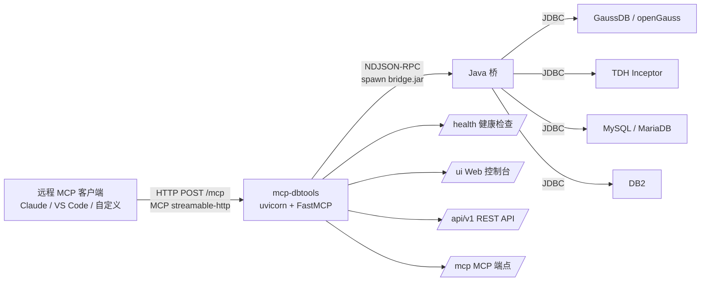

# mcp-dbtools 使用操作说明

> 本文档面向**运维 / 使用人员**，说明如何部署、配置、调用与维护 mcp-dbtools
> 数据库 MCP 服务。
> 对应版本：**v1.2.1** · 更新历史见 [CHANGELOG](../CHANGELOG.md)

---

## 1. 项目简介

mcp-dbtools 是一个基于 **Python + JDBC** 的数据库 MCP（Model Context Protocol）服务，
供 LLM 客户端（如 Claude、VS Code Copilot、自定义程序）通过标准 MCP 协议查询数据库。

**支持的数据源：**

| 数据源 | JDBC 驱动 | JDBC URL 示例 |
| --- | --- | --- |
| GaussDB / openGauss | `org.opengauss.Driver` | `jdbc:opengauss://host:5432/db` |
| TDH Inceptor（星环） | `org.apache.hive.jdbc.HiveDriver` | `jdbc:hive2://host:10000/default` |
| DB2 | `com.ibm.db2.jcc.DB2Driver` | `jdbc:db2://host:50000/db` |
| MySQL / MariaDB | `com.mysql.cj.jdbc.Driver` | `jdbc:mysql://host:3306/db?useUnicode=true&characterEncoding=UTF-8` |
| 其他 Hive 兼容 | `org.apache.hive.jdbc.HiveDriver` | `jdbc:hive2://...` |
| 其他 PostgreSQL 兼容 | `org.postgresql.Driver` | `jdbc:postgresql://...` |

**运行形态：** 服务部署在服务器上，通过 HTTP 对外提供 MCP 端点（`streamable-http`，
也支持 SSE 与本地 stdio）。

**架构：**



---

## 2. 快速部署

### 2.1 开发 / 调试环境（本机）

```bash
# 1. 创建虚拟环境并安装依赖
python3 -m venv .venv
. .venv/bin/activate
pip install -r requirements.txt
pip install -e .

# 2. 生成配置
cp config/datasources.json.example config/datasources.json
cp .env.example .env          # 按需修改密码

# 3. 构建 Java 桥 bridge.jar（数据面，JDBC 访问靠它；需 node + JDK 17+）
bash scripts/build_bridge.sh  # 从并排的 open-dbclient 仓库构建，产物放到项目根

# 4. 下载 JDBC 驱动（openGauss / MySQL；DB2 驱动需手工放入 drivers/）
python scripts/download_drivers.py

# 5. 启动 HTTP 服务（会自动 spawn Java 桥子进程）
python -m mcp_dbtools --transport streamable-http
# 服务地址: http://<服务器IP>:8000/mcp
```

### 2.2 验证启动

```bash
# 健康检查（免鉴权）
curl http://127.0.0.1:8000/health
# 深度健康检查（真实 SELECT 1 探测每个数据源）
curl "http://127.0.0.1:8000/health?deep=1"
```

### 2.3 内网生产部署（pm2 离线包）

适用于**无法访问外网**的内网服务器（无 Docker 或不允许 Docker 时）。支持 **Linux** 与 **Windows** 两个平台。

#### 生成离线包（外网构建机）

```bash
# 先构建 Java 桥（产物 bridge.jar 会被一起打包；需 node + JDK 17+）
bash scripts/build_bridge.sh
# Linux 离线包（默认，tar.gz，manylinux wheel）
bash scripts/build_offline.sh --platform linux
# Windows 离线包（zip，win_amd64 wheel）
bash scripts/build_offline.sh --platform windows
# 同时生成两个
bash scripts/build_offline.sh --platform all
# 产物: mcp-dbtools-offline-linux-*.tar.gz / mcp-dbtools-offline-windows-*.zip
```

> 离线包内容：项目 wheel（`dist/`）+ 全部运行时依赖 wheel + **开发依赖 wheel**（pytest / pytest-asyncio /
> setuptools / wheel）+ **完整源码快照 `source/`**（供内网二次开发）+ **Java 桥 `bridge.jar`** +
> JDBC 驱动 + 配置示例 + 安装/升级脚本 + 二次开发指南（`README-二次开发.md`）。
> 源码快照由构建机 `git archive HEAD` 生成，**只包含已提交内容**；构建时若工作区有未提交改动会打印 `[WARN]`。

#### Linux 安装

```bash
tar -xzf mcp-dbtools-offline-linux-*.tar.gz
bash mcp-dbtools-offline-linux/install.sh
# 会创建 .venv、离线安装依赖、生成 .env、pm2 start
```

#### Windows 安装

```
解压 mcp-dbtools-offline-windows-*.zip 到目标目录（如 D:\mcp-dbtools），
双击 install_offline.bat（自动建 venv + 离线装依赖 + 生成 .env/datasources.json + 注册服务）
```

**目标机什么环境都没有（无 Python / JDK / Node）时**，用自包含包：

```bash
# 外网构建机
bash scripts/build_offline.sh --platform windows --self-contained   # 包约 74 MB
```

包内已展开便携运行时（`runtime\python` 便携 CPython、`runtime\jre` Temurin JRE 17），
目标机解压后直接运行 `install_offline.bat` 即可 —— **免安装、免管理员、不写 PATH/注册表**，
也不会动目标机已有的 Python。安装脚本优先用系统运行时，缺失时才回退到包内运行时。

#### Windows 服务管理

安装后不再强制依赖 pm2：**有 pm2 就沿用 pm2，没有就用 Windows 自带计划任务**。

```bat
cd /d D:\mcp-dbtools
mcp-dbtools-service.cmd install    :: 创建自启任务（管理员=开机自启，普通用户=登录自启）
mcp-dbtools-service.cmd start ^| stop ^| restart ^| status ^| logs ^| remove
mcp-dbtools-run.cmd                :: 前台调试运行（自动设置 JAVA_HOME 与工作目录）
```

#### 升级（已有旧版本安装）

```bash
# Linux：解压新版包，执行升级脚本（自动备份 .env/datasources.json、更新依赖、重启服务）
tar -xzf mcp-dbtools-offline-linux-*.tar.gz
bash mcp-dbtools-offline-linux/upgrade.sh /opt/mcp-dbtools
```
```
Windows：解压新版 zip，执行 upgrade_offline.bat <旧安装目录>
（自动备份配置、更新代码依赖、重启服务，保留 .env 与 datasources.json）
```

> 升级脚本会自动：把 `.env`、`config/datasources.json` **以及 `source/` 源码目录**（可能含二次开发改动）
> 备份到 `backup-时间戳/`，再更新代码与依赖并重启服务。
> 项目 wheel 使用 `--force-reinstall` 强制重装 —— 因为**新旧版本号相同时 pip 会跳过安装**
> （提示 `already installed with the same version`），只更新依赖而不更新代码；升级结束会打印
> 「包内 wheel 版本 | 已安装版本」供核对，两者应一致。
> **Windows 升级前必须先 `pm2 stop mcp-dbtools`**：运行中的进程会锁定 venv 里的编译产物（`.pyd`），
> 导致依赖文件覆盖失败。

#### 内网二次开发（可选）

离线包内含完整源码与开发依赖 wheel，内网可直接改代码、跑测试（详见包内 `README-二次开发.md`）：

```bash
# Linux（Windows 把路径换成 D:\mcp-dbtools\source，pip 换成 .venv\Scripts\pip）
cd /opt/mcp-dbtools/source
python3 -m venv .venv
.venv/bin/pip install --no-index --find-links=../wheels -e .          # -e：改代码立即生效
.venv/bin/pip install --no-index --find-links=../wheels -r requirements-dev.txt
.venv/bin/python -m pytest -q                                        # 集成测试缺库时自动 skip
```

> 开发用 Python 版本同样必须是 **3.13**（与包内 wheel 的 `cp3xx` 标签一致）；`3.8` 环境不可用。

#### 日常管理命令（安装目录执行）

```bash
cd /opt/mcp-dbtools
pm2 start ecosystem.config.cjs   # 首次/手动启动
pm2 save                         # 保存进程列表（配合 pm2 startup 开机自启）
pm2 logs mcp-dbtools             # 查看日志
pm2 reload mcp-dbtools           # 重启
pm2 stop mcp-dbtools             # 停止
```

> 前置：内网机需已安装 **JRE/JDK 17+**（运行 Java 桥）与 **Node.js/pm2**；
> Python 版本必须与离线包一致（包内 `python-version-required.txt` 记录，Linux 包为 3.13 / Windows 包为 3.13 64 位），
> 因为依赖含 `cp3xx` 二进制 wheel，**不能跨 Python 版本**安装。
> **Python 3.8 无法使用**：`mcp` SDK 全部版本要求 `>=3.10`（`pip` 会报 `No matching distribution found for mcp`）。
> Windows 包内已附带 CPython 官方安装器，可在低版本机器上**并行安装 3.13**（`install_offline.bat` 会自动提示）；
> Linux 低版本机器需自行准备 Python 3.13 后再执行 `install.sh`。
> 构建机与内网机需同为对应平台。

### 2.4 systemd 方式

也可使用 `deploy/mcp-dbtools.service` 交由 systemd 托管，修改其中的路径后：

```bash
sudo cp deploy/mcp-dbtools.service /etc/systemd/system/
sudo systemctl daemon-reload
sudo systemctl enable --now mcp-dbtools
```

---

## 3. 配置说明

### 3.1 数据源配置（config/datasources.json）

```json
{
  "datasources": [
    {
      "name": "gaussdb_test",
      "type": "gaussdb",
      "description": "Docker 测试库（openGauss 5.0）",
      "driver_class": "org.opengauss.Driver",
      "jdbc_url": "jdbc:opengauss://127.0.0.1:5432/gaussdb",
      "username": "gaussdb",
      "password": "{ENV:GAUSS_PASSWORD}",
      "jars": ["opengauss-jdbc-5.0.0-og.jar"]
    },
    {
      "name": "tdh_inceptor",
      "type": "tdh",
      "description": "TDH Inceptor",
      "driver_class": "org.apache.hive.jdbc.HiveDriver",
      "jdbc_url": "jdbc:hive2://127.0.0.1:10000/default",
      "username": "tdh",
      "password": "{ENV:TDH_PASSWORD}",
      "jars": ["inceptor-jdbc.jar"]
    },
    {
      "name": "db2_test",
      "type": "db2",
      "description": "DB2 测试库",
      "driver_class": "com.ibm.db2.jcc.DB2Driver",
      "jdbc_url": "jdbc:db2://127.0.0.1:50000/testdb",
      "username": "db2inst1",
      "password": "{ENV:DB2_PASSWORD}",
      "jars": ["db2jcc4.jar"]
    },
    {
      "name": "mysql_test",
      "type": "mysql",
      "description": "MySQL 测试库（注意 JDBC URL 需带 UTF-8 字符集参数）",
      "driver_class": "com.mysql.cj.jdbc.Driver",
      "jdbc_url": "jdbc:mysql://127.0.0.1:3306/testdb?useUnicode=true&characterEncoding=UTF-8",
      "username": "mysql",
      "password": "{ENV:MYSQL_PASSWORD}",
      "jars": ["mysql-connector-j-8.4.0.jar"]
    }
  ]
}
```

字段说明：

| 字段 | 必填 | 说明 |
| --- | --- | --- |
| `name` | ✅ | 数据源唯一标识，MCP 工具用 `datasource` 参数引用 |
| `type` | ✅ | 仅用于健康探测 ping 语句（`db2` 用 `SELECT 1 FROM SYSIBM.SYSDUMMY1`）；元数据走 JDBC `DatabaseMetaData` 能力探测，与 `type` 无关 |
| `jdbc_url` | ✅ | JDBC 连接串 |
| `driver_class` | ✅ | JDBC 驱动类全名 |
| `username` / `password` | 视驱动 | 密码**推荐用 `{ENC:...}` 加密存储**（见下），也可 `{ENV:VAR}` 引用环境变量 |
| `jars` | ✅ | JDBC 驱动 jar 文件名（放在 `drivers/` 目录） |
| `description` | 否 | 数据源说明 |
| `properties` | 否 | 额外连接属性 |

### 3.1.1 密码加密存储（推荐，不留明文）

配置文件（或备份/版本库）中**不应出现明文密码**。使用 `{ENC:...}` 加密串存储，
运行时用密钥 `MCP_DBTOOLS_SECRET_KEY` 自动解密（AES-256-GCM 认证加密，防篡改）。

**第一步：在 `.env` 配置密钥（妥善保管，勿提交代码库）**
```bash
MCP_DBTOOLS_SECRET_KEY=<你的强密钥>
```

**第二步：用工具生成加密串**（二选一）
```bash
# 推荐：从标准输入读取，明文不落 shell 历史
echo -n "Gauss@123" | MCP_DBTOOLS_SECRET_KEY=<密钥> python scripts/encrypt_password.py --stdin
# 或直接传参（明文会出现在 shell 历史）
MCP_DBTOOLS_SECRET_KEY=<密钥> python scripts/encrypt_password.py "Gauss@123"
# 输出示例: {ENC:...}（base64 密文）
```

**第三步：把输出填入 datasources.json**
```json
"password": "{ENC:xxxxxxxxxxxx}"
```

要点：
- 加密与运行需使用**同一个** `MCP_DBTOOLS_SECRET_KEY`；换密钥需重新生成各数据源密文；
- 密钥错误或密文被篡改时，服务启动会**明确报错**（不会静默连错库）；
- `{ENV:VAR}` 方式仍兼容（密码在环境变量中），但推荐改用 `{ENC:...}`；
- 该机制防「配置文件泄露时密码可读」，对外访问仍建议 HTTPS / 内网。

### 3.2 环境变量（.env）完整清单

服务会自动加载项目根目录 `.env`。以下为全部可配置项（默认值）：

#### 服务基础
| 变量 | 默认值 | 说明 |
| --- | --- | --- |
| `MCP_DBTOOLS_HOST` | `0.0.0.0` | 监听地址 |
| `MCP_DBTOOLS_PORT` | `8000` | 监听端口 |
| `MCP_DBTOOLS_TRANSPORT` | `streamable-http` | `streamable-http` / `sse` / `stdio` |
| `MCP_DBTOOLS_AUTH_TOKEN` | 空 | 设置后 HTTP 调用需携带 `Authorization: Bearer <token>` |
| `MCP_DBTOOLS_MODE` | `local` | 部署形态：`local` / `remote`；remote 强制要求 Token |
| `MCP_DBTOOLS_ALLOW_REMOTE_EDIT` | `false` | remote 模式下是否允许经 API/控制台修改数据源配置 |
| `MCP_DBTOOLS_CONFIG` | `config/datasources.json` | 数据源配置路径 |
| `MCP_DBTOOLS_DRIVERS_DIR` | `drivers` | JDBC 驱动目录 |

#### Java 桥（JDBC 访问）
| 变量 | 默认值 | 说明 |
| --- | --- | --- |
| `MCP_DBTOOLS_BRIDGE_JAR` | `bridge.jar` | Java 桥 jar 路径（`scripts/build_bridge.sh` 构建，由服务自动 spawn） |
| `MCP_DBTOOLS_JAVA` | `java` | Java 可执行文件（JRE/JDK 17+） |
| `MCP_DBTOOLS_BRIDGE_TIMEOUT` | `120` | 桥请求默认超时（秒） |
| `MCP_DBTOOLS_BRIDGE_URL` | 空 | 远程共享桥地址 `host:port`；设置后连已部署的桥服务（多客户端共用一个 JVM），不设置则本地 spawn |
| `MCP_DBTOOLS_BRIDGE_TOKEN` | 空 | 共享桥的鉴权密钥（对应 `--listen --token`）；桥设置了 token 时必填 |
| `MCP_DBTOOLS_TENANT_ID` | 空 | 租户标识：多服务共用一个共享桥时各自设唯一值，隔离连接归属 |

#### 密码安全
| 变量 | 默认值 | 说明 |
| --- | --- | --- |
| `MCP_DBTOOLS_SECRET_KEY` | 空 | 解密 `{ENC:...}` 密码的主密钥；配置含加密密码时**必须设置** |
| `GAUSS_PASSWORD` | `Gauss@123` | 示例：GaussDB 密码（`{ENV:GAUSS_PASSWORD}` 引用，测试库默认） |
| `TDH_PASSWORD` | `tdh` | 示例：TDH 密码（`{ENV:TDH_PASSWORD}` 引用） |
| `DB2_PASSWORD` | `password` | 示例：DB2 密码（`{ENV:DB2_PASSWORD}` 引用） |
| `MYSQL_PASSWORD` | `mysql123` | 示例：MySQL 密码（`{ENV:MYSQL_PASSWORD}` 引用） |

#### 查询与连接
| 变量 | 默认值 | 说明 |
| --- | --- | --- |
| `MCP_DBTOOLS_MAX_ROWS` | `300` | 单次查询默认返回行数上限 |
| `MCP_DBTOOLS_MAX_ROWS_LIMIT` | `10000` | `limit` 参数允许的最大值 |
| `MCP_DBTOOLS_CONNECT_TIMEOUT` | `30` | 连接超时（秒） |
| `MCP_DBTOOLS_POOL_SIZE` | `2` | 每数据源 JDBC 连接池大小 |

#### 熔断
| 变量 | 默认值 | 说明 |
| --- | --- | --- |
| `MCP_DBTOOLS_CIRCUIT_FAIL_THRESHOLD` | `3` | 连续失败 N 次触发熔断 |
| `MCP_DBTOOLS_CIRCUIT_COOLDOWN` | `30` | 熔断冷却时间（秒） |

#### 大数据量导出
| 变量 | 默认值 | 说明 |
| --- | --- | --- |
| `MCP_DBTOOLS_EXPORT_DIR` | `exports` | 导出文件目录 |
| `MCP_DBTOOLS_EXPORT_MAX_ROWS` | `100000` | 单次导出最大行数 |
| `MCP_DBTOOLS_EXPORT_KEEP_SECONDS` | `86400` | 导出文件保留时长（1 天），过期自动清理 |
| `MCP_DBTOOLS_EXPORT_MAX_FILES` | `100` | 最多保留的导出文件数 |

#### 监控与审计
| 变量 | 默认值 | 说明 |
| --- | --- | --- |
| `MCP_DBTOOLS_HISTORY_SIZE` | `500` | 执行历史环形缓冲条数 |
| `MCP_DBTOOLS_AUDIT_FILE` | `logs/audit.jsonl` | 审计 JSONL 路径，置空关闭落盘 |
| `MCP_DBTOOLS_AUDIT_DB` | `logs/audit.db` | 审计 SQLite 库（审计页面数据源） |
| `MCP_DBTOOLS_METRICS_ENABLED` | `true` | 是否开放 `/metrics` |
| `MCP_DBTOOLS_AUDIT_MAX_BYTES` | `10485760` | 审计单文件超过后自动轮转（10MB） |
| `MCP_DBTOOLS_AUDIT_BACKUP_COUNT` | `5` | 审计轮转保留备份份数 |

#### 健康检查与限流
| 变量 | 默认值 | 说明 |
| --- | --- | --- |
| `MCP_DBTOOLS_HEALTH_CHECK_INTERVAL` | `30` | 后台探活/自动重连间隔（秒） |
| `MCP_DBTOOLS_RATE_LIMIT_ENABLED` | `true` | 是否启用按 IP 的 QPS 限流 |
| `MCP_DBTOOLS_RATE_LIMIT_QPS` | `10` | 每客户端每秒请求上限 |
| `MCP_DBTOOLS_RATE_LIMIT_BURST` | `20` | 突发令牌容量 |

#### 缓存与事务
| 变量 | 默认值 | 说明 |
| --- | --- | --- |
| `MCP_DBTOOLS_META_CACHE_TTL` | `60` | 元数据查询缓存有效期（秒），`0` 关闭 |
| `MCP_DBTOOLS_META_CACHE_MAX_ITEMS` | `256` | 元数据缓存最大条目数 |
| `MCP_DBTOOLS_TX_TIMEOUT` | `300` | 事务最大持续时间（秒），超时自动回滚 |

#### 服务日志（落盘 + 轮转）
| 变量 | 默认值 | 说明 |
| --- | --- | --- |
| `MCP_DBTOOLS_LOG_FILE` | `logs/app.log` | 应用日志文件路径；设为空则仅输出控制台 |
| `MCP_DBTOOLS_LOG_MAX_BYTES` | `10485760` | 单日志文件超过后自动轮转 `.1/.2/...`（10MB） |
| `MCP_DBTOOLS_LOG_BACKUP_COUNT` | `5` | 日志轮转保留备份份数 |

#### 脚本执行
| 变量 | 默认值 | 说明 |
| --- | --- | --- |
| `MCP_DBTOOLS_SCRIPT_ROOT` | `scripts/sql` | SQL 脚本根目录（`execute_script` 限定于此） |

---

## 4. HTTP 端点一览

| 端点 | 鉴权 | 说明 |
| --- | --- | --- |
| `POST /mcp` | ✅ 需要 | **MCP 端点**，LLM 客户端调用工具走这里 |
| `GET /health` | ❌ 免鉴权 | 健康检查；`?deep=1` 深度探测（真实 SELECT 1） |
| `GET /metrics` | ✅ 需要 | 监控 JSON：数据源状态、内存、工具统计、缓存、事务 |
| `GET /ui/` | ❌ 免鉴权 | **Web 控制台**（概览/数据源/查询/导出/审计/日志），页面外壳免鉴权 |
| `GET /api/v1/system/*` | ✅ 需要 | 元信息 / 健康 / 指标 / 脱敏配置 |
| `GET/POST/PUT/DELETE /api/v1/datasources*` | ✅ 需要 | 数据源维护（remote 模式默认只读） |
| `POST /api/v1/query/execute` | ✅ 需要 | 执行 SQL（写操作需 `confirm=true`，落审计） |
| `GET /api/v1/query/history` | ✅ 需要 | 执行历史 |
| `GET/POST /api/v1/exports*` | ✅ 需要 | 导出任务创建 / 查询 |
| `GET /api/v1/exports/{id}/download` | ✅ 需要 | 下载异步导出的文件 |
| `GET /api/v1/audit/*` | ✅ 需要 | 审计记录 / 详情 / 汇总 |
| `GET /api/v1/logs` | ✅ 需要 | 服务日志尾部（`lines`、`q`） |
| `GET /api/v1/metadata/*` | ✅ 需要 | 库/表/字段浏览 |

> 鉴权方式：请求头 `Authorization: Bearer <token>`，或 URL 参数 `?token=<token>`。
> 统一响应包与分组规范见 [架构设计.md](架构设计.md) 第 6 节。

---

## 5. MCP 工具

共 **20 个**工具。**参数不用背**：服务自带自描述接口，直接查注册表即可。

```bash
curl -H "Authorization: Bearer $TOKEN" http://<服务器>:8000/api/v1/mcp/tools
curl -H "Authorization: Bearer $TOKEN" "http://<服务器>:8000/api/v1/mcp/tools?group=事务"
curl -H "Authorization: Bearer $TOKEN" http://<服务器>:8000/api/v1/mcp/info
```

或打开控制台 `http://<服务器>:8000/ui/tools`（按组展示、可搜索、展开看参数 schema）。
`/api/v1/mcp/tools` 与 MCP 的 `tools/list` 同源，不会出现文档过期。

| 分组 | 工具 |
| --- | --- |
| 连接与元数据 | `list_datasources` `test_connection` `list_schemas` `list_tables` `describe_table` |
| 查询与脚本 | `execute_query` `execute_script` `save_script` |
| 事务 | `begin_transaction` `execute_in_transaction` `commit_transaction` `rollback_transaction` `get_transaction_status` |
| 监控与审计 | `get_status` `get_datasource_status` `get_circuit_status` `get_execution_history` |
| 导出 | `start_export` `get_export_status` `list_exports` |

通用约定：

- `datasource` 传 `datasources.json` 里的数据源 `name`（先调 `list_datasources`）。
- **写操作**（DELETE/UPDATE/INSERT/DROP/TRUNCATE 等）默认被拦截，必须 `confirm=true` 才执行并记审计。
- 所有调用都记审计（时间、调用方 IP/UA、参数、耗时、成败）。

典型链路：

```text
list_datasources → list_tables → describe_table → execute_query → start_export
```

## 6. 客户端接入方式

### 6.1 命令行验证（mcp_client_demo.py）

```bash
.venv/bin/python scripts/mcp_client_demo.py --url http://127.0.0.1:8000/mcp \
    --token <MCP_DBTOOLS_AUTH_TOKEN> \
    --datasource gaussdb_test --sql "SELECT * FROM employees LIMIT 5"
```

### 6.2 Claude Desktop / VS Code 等 MCP 客户端

配置 MCP server 为 streamable-http 模式，指向 `http://<服务器>:8000/mcp`，
并在请求头携带 `Authorization: Bearer <token>`（若开启了鉴权）。

### 6.3 通用 curl 调用 /mcp

```bash
curl -X POST http://127.0.0.1:8000/mcp \
  -H "Authorization: Bearer <token>" \
  -H "Content-Type: application/json" \
  -H "Accept: application/json, text/event-stream" \
  -d '{"jsonrpc":"2.0","method":"tools/list","id":1,"params":{}}'
```

---

## 7. 安全机制说明

| 机制 | 说明 | 配置 |
| --- | --- | --- |
| **Bearer 鉴权** | 未携带正确 token 返回 401 | `MCP_DBTOOLS_AUTH_TOKEN` |
| **数据源白名单** | 工具只能连配置内预定义连接，无法注入任意 JDBC URL | 配置文件 |
| **写操作二次确认** | DELETE/UPDATE 等默认拦截，需 `confirm=true` 并记审计 | 内置 |
| **脚本路径限制** | `execute_script` 只能执行脚本根目录内文件（防目录穿越） | `MCP_DBTOOLS_SCRIPT_ROOT` |
| **不暴露服务器路径** | 工具响应/报错只回脚本根目录内的相对路径，不输出绝对路径 | — |
| **只读模式** | `execute_script` 默认只允许 SELECT/SHOW/DESCRIBE/EXPLAIN/WITH | `read_only` |
| **熔断** | 连续失败 N 次触发熔断，冷却后半开恢复 | `MCP_DBTOOLS_CIRCUIT_*` |
| **行数限制** | 单次查询默认 300 行、上限 10000，防 OOM | `MCP_DBTOOLS_MAX_ROWS*` |
| **限流** | 按客户端 IP 令牌桶限 QPS，超限 429 | `MCP_DBTOOLS_RATE_LIMIT_*` |
| **审计** | 全部调用落盘（JSONL + SQLite），含 IP/UA/参数/耗时 | `MCP_DBTOOLS_AUDIT_*` |
| **敏感信息** | 数据源密码经 `{ENV:VAR}` 注入，接口返回不包含密码 | 配置文件 |

---

## 8. 监控与人工审计

### 8.1 人工审计页面

浏览器访问 `http://<服务器>:8000/ui/audit`，可：

- **查询**：按工具、IP、成败、关键字、时间范围分页检索审计记录；
- **详情**：查看单条记录的完整参数；
- **统计**：总量、今日、成功/失败、Top 工具与 IP 概览；
- **导出 CSV**：按当前筛选条件导出审计数据。

> 页面外壳免鉴权，数据接口 `GET /api/v1/audit/*` 需要 token（控制台会自动弹窗索取）。
> 第三方系统对接直接用 REST API：`/api/v1/audit/events`、`/api/v1/audit/events/{id}`、`/api/v1/audit/summary`。

### 8.2 /metrics 监控指标

带 token 访问 `http://<服务器>:8000/metrics`，返回 JSON：
数据源连接/查询/错误统计、JVM 与进程内存、工具调用统计、元数据缓存命中、事务状态等。

### 8.3 审计落盘文件

- `logs/audit.jsonl`：JSONL 审计日志，单文件超过 10MB 自动轮转为 `.1/.2/...`（保留 5 份）；
- `logs/audit.db`：SQLite 审计库（审计页面查询数据源）。

### 8.4 服务日志查看

服务运行日志默认落盘到 `logs/app.log`（按大小轮转），两个查看途径：

1. **网页查看**：浏览器访问 `http://<服务器>:8000/ui/logs`
   - 支持尾部行数选择（1–2000）、**关键字过滤**（如 `ERROR`、数据源名）、手动刷新；
   - 页面外壳免鉴权，数据接口 `GET /api/v1/logs` 需 token。
2. **命令行**：
   ```bash
   tail -f logs/app.log                 # 直接看文件
   pm2 logs mcp-dbtools                 # pm2 部署时看 stdout/stderr
   ```

> 日志文件只保留最近的 `LOG_BACKUP_COUNT` 份（默认 5 份、每份 10MB），不会无限膨胀。

---

## 9. 常见问题（FAQ）

**Q1：为什么查询报"检测到写操作语句"？**
因为 SQL 是写操作（DELETE/UPDATE/INSERT 等）且未传 `confirm=true`。确认无误后传入
`confirm=true` 即可（会记审计）。

**Q2：查询返回的行数只有 300 行？**
这是防 OOM 的保护。要拿全量数据，请改用 `start_export` 异步导出。

**Q3：提示"数据源处于熔断状态"？**
数据源连续失败触发了熔断。等待冷却（默认 30s）后自动恢复，或排查数据库连通性后重启服务。

**Q4：调用返回 HTTP 429？**
触发了按 IP 的限流。稍等片刻（令牌补充）再试，或调大 `MCP_DBTOOLS_RATE_LIMIT_QPS/BURST`。

**Q5：事务提示"已有活动事务"？**
同一数据源同一时间只允许一个事务。先 commit/rollback 旧的；若怀疑超时未释放，用
`get_transaction_status` 查看，超过 `TX_TIMEOUT` 会自动回滚。

**Q6：配置改了没生效？**
数据源配置与 `.env` 在启动时加载，修改后需重启服务（`pm2 reload mcp-dbtools`）。

**Q7：TDH/Inceptor 连不上？**
确认 TDH 驱动 jar 已放入 `drivers/`（如 `inceptor-jdbc.jar`）且数据栈（HDFS/YARN/Inceptor）
已部署，端口 10000 可达。

**Q8：JVM 相关报错？**
确认已安装 JRE/JDK 17+（Java 桥 `bridge.jar` 需 17+）。`java -version` 应显示 17 或更高。

---

## 10. 目录结构速览

```
mcp-dbtools/
├── src/mcp_dbtools/
│   ├── server.py      # CLI 入口（参数/日志/transport）
│   ├── app.py         # ASGI 装配（MCP + /api/v1 + /ui + 中间件）
│   ├── api/           # REST API 分组（system/datasources/query/metadata/exports/audit/logs）
│   ├── web/           # Web 控制台（/ui，零构建静态单页）
│   ├── services/      # 业务逻辑：数据源配置读写、日志读取
│   ├── bridge.py      # Java 桥客户端（NDJSON-RPC）
│   ├── jdbc.py        # 查询、元数据缓存、熔断、事务、健康检查
│   ├── tools.py       # 20 个 MCP 工具定义
│   ├── config.py      # 配置加载（datasources.json + 环境变量）
│   ├── monitor.py     # 审计（JSONL 轮转 + SQLite）、执行历史、指标
│   ├── export.py      # 异步导出 + 过期文件清理
│   ├── crypto.py      # 密码加密存储（{ENC:...}）
│   └── ratelimit.py   # 令牌桶限流中间件
├── config/datasources.json    # 数据源配置
├── drivers/                   # JDBC 驱动 jar
├── scripts/                   # 驱动下载、客户端演示、离线构建脚本
├── scripts/sql/               # SQL 脚本根目录（execute_script 使用）
├── deploy/                    # pm2 / systemd 部署文件
├── exports/                   # 导出文件目录（自动清理）
└── logs/                      # 审计日志
```
