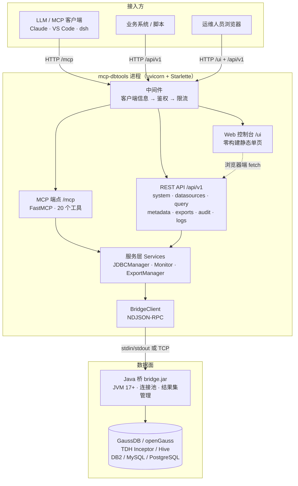
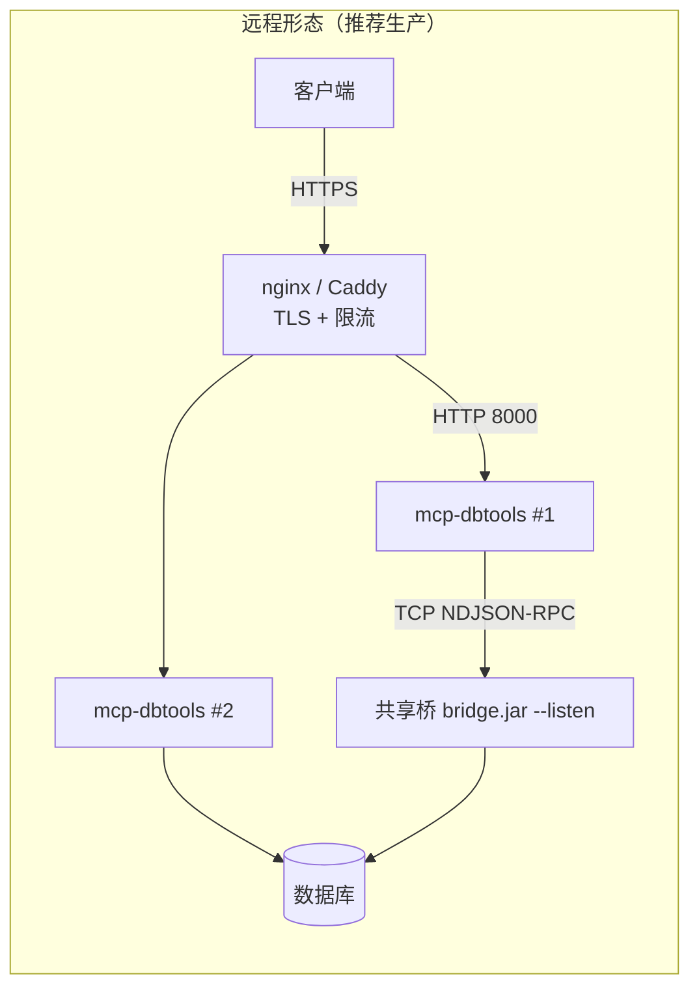

# mcp-dbtools 架构设计与接口规范

> 状态：**骨架已落地，可运行**（`/api/v1` + `/ui` 已可用，旧 URL 已下线）。
> 本文是评审基线：先看第 2–4 节确认分层与目录，再看第 5–7 节确认路由与 API 分组，
> 第 10 节是旧版本迁移对照。

## 1. 设计目标与边界

**目标**

1. 一个进程同时提供三种对外形态：**MCP 工具**（LLM 客户端）、**REST API**（系统对接）、
   **Web 控制台**（人工运维），三者共用同一套服务层，不重复实现业务。
2. 同一份代码支持**本地**（单机/内网、stdio 或 localhost）与**远程**（对外 HTTP 服务、
   多客户端、反代 + TLS）两种部署形态，靠配置切换而非分叉代码。
3. URL 与 API 分组稳定、可预期；前端零构建（纯静态资源），离线包与内网部署不引入 node。

**非目标（本阶段明确不做）**

- 不做多用户账号体系/细粒度 RBAC（保留单 Token + 租户标识，见 §8）；
- 不做 ORM/数据库迁移框架（配置仍是 JSON 文件，审计仍走 SQLite）；
- 不做前端构建链（不引入 React/Vite），不追求复杂交互；
- 不在 Web 端实现库表 DDL 编辑、数据编辑（只读浏览 + 查询 + 导出）。

## 2. 总体架构



**分层职责**

| 层 | 模块 | 只做这些事 |
| --- | --- | --- |
| 入口 | `server.py` | 解析命令行、初始化日志、选择传输方式 |
| 装配 | `app.py` | 构建核心对象、注册路由与中间件、启动 HTTP |
| 传输 | `api/`、`web/`、FastMCP | 协议适配：HTTP 语义、响应包、页面路由 |
| 服务 | `jdbc.py`、`monitor.py`、`export.py`、`services/` | 业务逻辑，与传输无关 |
| 数据面 | `bridge.py` + `bridge.jar` | JDBC 访问、连接池、结果集分页 |

依赖方向严格单向：`传输层 → 服务层 → 桥`。服务层不 import 任何 HTTP/MCP 模块。

## 3. 两种部署形态

| 形态 | `MCP_DBTOOLS_MODE` | 典型场景 | 传输 | 鉴权 | 数据源编辑 |
| --- | --- | --- | --- | --- | --- |
| **本地** | `local`（默认） | 开发者本机、单机内网、stdio 接入 IDE | stdio 或 `127.0.0.1:8000` | 可选 Token | 允许（控制台可改） |
| **远程** | `remote` | 服务器集中部署，多客户端/多系统共用 | HTTP（反代 + TLS） | **强制 Token**（启动校验） | **默认只读**，需 `MCP_DBTOOLS_ALLOW_REMOTE_EDIT=1` |

**本地形态**

- stdio：`MCP_DBTOOLS_TRANSPORT=stdio`，由 IDE/客户端拉起进程，无 HTTP、无控制台；
- HTTP 本地：监听 `127.0.0.1`，浏览器打开 `http://127.0.0.1:8000/ui/`，桥在本机 spawn。

**远程形态**

- 必须设置 `MCP_DBTOOLS_MODE=remote` + `MCP_DBTOOLS_AUTH_TOKEN`，否则启动直接失败；
- HTTP 服务交给反向代理终结 TLS（nginx/Caddy），应用只监听内网端口；
- 数据源配置可挂载为只读文件，通过 `MCP_DBTOOLS_ALLOW_REMOTE_EDIT` 控制控制台是否可写；
- 桥的两种接法：
  - **随进程 spawn**：服务与数据库同网段时最省事，一个服务实例一个 JVM；
  - **共享桥**：`MCP_DBTOOLS_BRIDGE_URL=bridge-host:19099` + `BRIDGE_TOKEN` + `TENANT_ID`，
    多个服务实例共用一个 JVM/连接池，适合容器水平扩容。



## 4. 目录结构（目标态）

```
src/mcp_dbtools/
├── server.py              # CLI 入口：参数 / 日志 / transport 选择
├── app.py                 # ASGI 装配：MCP + /api/v1 + /ui + 中间件
├── api/                   # REST API（每个模块 = 一个资源分组）
│   ├── deps.py            # 响应包 / 错误码 / 参数解析 / Services 容器 / 路由装配
│   ├── system.py          # /api/v1/system + 运维端点 /health /metrics
│   ├── mcp.py             # /api/v1/mcp（工具清单与参数 schema 自描述）
│   ├── datasources.py     # /api/v1/datasources（脱敏、远程只读保护）
│   ├── query.py           # /api/v1/query（执行 + 历史 + 统计，写操作审计）
│   ├── metadata.py        # /api/v1/metadata（schema / table / column）
│   ├── exports.py         # /api/v1/exports（异步导出 + 下载）
│   ├── audit.py           # /api/v1/audit（审计查询）
│   └── logs.py            # /api/v1/logs（日志尾部）
├── web/                   # Web 控制台（零构建）
│   ├── __init__.py        # /ui 路由 + 静态资源挂载 + SPA 回落
│   └── static/
│       ├── index.html     # 应用外壳（侧边栏 + 视图容器）
│       └── assets/        # app.js（History 路由 + fetch）、style.css
├── services/              # 与传输无关的业务逻辑
│   ├── datasources.py     # datasources.json 读写、密码加密、脱敏
│   └── logs.py            # 日志尾部读取
├── tools.py               # MCP 工具定义（20 个，全部经 wrap_tool 记审计）
├── jdbc.py                # 数据访问：查询/元数据/事务/健康/熔断/缓存/脚本
├── bridge.py              # Java 桥客户端（spawn / remote，NDJSON-RPC）
├── monitor.py             # 审计（JSONL + SQLite）、执行历史、指标
├── export.py              # 异步导出任务与文件清理
├── config.py              # 配置加载（环境变量 + datasources.json + 解密）
├── crypto.py              # {ENC:...} AES-256-GCM
└── ratelimit.py           # 令牌桶限流中间件
```

> 与旧版差异：删除 `home_page.py` / `audit_page.py` / `logs_page.py` / `datasources_page.py`
> 四个"Python 里拼 HTML"的模块，页面统一收敛到 `web/static`，业务逻辑下沉到 `services/`。

## 5. URL 路由总表

| 路径 | 方法 | 鉴权 | 分组 | 说明 |
| --- | --- | --- | --- | --- |
| `/mcp` | POST/GET | ✅ | MCP | MCP streamable-http 端点 |
| `/health` | GET | ❌ | 运维 | 存活/就绪探针，`?deep=1` 逐库真实探测 |
| `/metrics` | GET | ✅ | 运维 | 指标 JSON（`MCP_DBTOOLS_METRICS_ENABLED` 控制） |
| `/api/v1/system/*` | GET | ✅ | system | 元信息 / 健康 / 指标 / 脱敏配置 |
| `/api/v1/mcp/*` | GET | ✅ | mcp | 工具清单 / 参数 schema / 能力信息 |
| `/api/v1/datasources*` | GET/POST/PUT/DELETE | ✅ | datasources | 数据源维护（远程默认只读） |
| `/api/v1/query/*` | GET/POST | ✅ | query | SQL 执行、执行历史、调用统计 |
| `/api/v1/metadata/*` | GET | ✅ | metadata | schema / table / column 浏览 |
| `/api/v1/exports*` | GET/POST | ✅ | exports | 导出任务创建 / 查询 / 下载 |
| `/api/v1/audit/*` | GET | ✅ | audit | 审计记录与汇总 |
| `/api/v1/logs` | GET | ✅ | logs | 服务日志尾部 |
| `/ui/`、`/ui/<section>` | GET | ❌（外壳） | Web | 控制台页面（数据仍走受保护 API） |
| `/ui/assets/*` | GET | ❌ | Web | 静态资源（JS/CSS） |
| `/` | GET | ✅ | Web | 307 跳转 `/ui/` |

> 页面外壳免鉴权是有意为之：浏览器地址栏无法携带 `Authorization`。
> 控制台启动后先调 `/api/v1/system/info`，401 时弹出 Token 输入框（存 sessionStorage）。

## 6. REST API 规范

### 6.1 版本与分组

- 前缀固定 `/api/v1`，破坏性变更升 `v2` 并保留旧版一个周期；
- 资源用**复数名词**，动词只出现在动作子资源上（`/datasources/{name}/test`）；
- 一个文件一个分组，分组内部禁止跨资源写（`query` 不修改数据源配置）。

### 6.2 统一响应包

成功：

```json
{ "ok": true, "data": { } }
```

失败：

```json
{ "ok": false, "error": { "code": "NOT_FOUND", "message": "数据源 'x' 不存在" } }
```

- `data` 可以是对象、数组包装对象或标量；
- `details` 仅在需要时出现（校验失败字段等），**永不包含密码、JDBC 连接串中的口令、
  服务器绝对路径**；
- 列表统一包成 `{ items, page, page_size, total, has_more }`（不分页的列表至少给
  `items` + `total`）。

### 6.3 错误码

| HTTP | code | 含义 |
| --- | --- | --- |
| 400 | `INVALID_PARAM` | 参数缺失/类型错误/业务校验失败（如重命名） |
| 401 | `UNAUTHORIZED` | 未携带或 Token 错误 |
| 403 | `FORBIDDEN` | 远程模式下的写操作，或策略禁止 |
| 404 | `NOT_FOUND` | 数据源 / 导出任务 / 审计记录 / 资源路径不存在 |
| 409 | `CONFLICT` | 名称冲突（数据源已存在） |
| 429 | `RATE_LIMITED` | 触发按 IP 限流（由中间件返回） |
| 500 | `INTERNAL_ERROR` | 未预期异常（堆栈只进服务日志） |
| 503 | `UPSTREAM_UNAVAILABLE` | 数据源不可用 / 桥不可用 / 连接失败 |

### 6.4 分页与筛选

- `page`（默认 1）、`page_size`（默认 20，上限 200，审计 200 / 日志 2000 行）；
- 时间筛选统一用 `from` / `to`（ISO8601 或 `YYYY-MM-DD HH:MM:SS`，含边界）；
- 布尔筛选用 `ok=1|0`，空字符串表示不过滤。

### 6.5 写操作与审计

- **SQL 写操作**（INSERT/UPDATE/DELETE/DROP/TRUNCATE…）：`execute` 必须显式
  `"confirm": true`，与 MCP 工具的 `confirm` 语义一致；
- **REST 执行的 SQL 同样落审计**，工具名加 `api.` 前缀（如 `api.query.execute`），
  与 MCP 工具调用（`execute_query`）可区分；
- **数据源配置写**（POST/PUT/DELETE）不落 SQL 审计，但要求 Token + 远程模式开关，
  且写入前统一走 `services.datasources` 的加密逻辑。

### 6.6 鉴权

- 单 Token：`Authorization: Bearer <token>`，兼容 `?token=`（MCP 客户端常用）；
- Token 来源 `MCP_DBTOOLS_AUTH_TOKEN`；为空时**不启用**鉴权中间件（仅本地形态可接受）；
- 远程形态启动时强制要求 Token（`config.load_settings` 校验）；
- Web 控制台不落 Cookie：Token 存 `sessionStorage`，可经 `?token=` 引导后自动从 URL 清除。

### 6.7 端点明细

**mcp**

| 方法 | 路径 | 说明 |
| --- | --- | --- |
| GET | `/api/v1/mcp/info` | 服务名、版本、传输方式、工具数量与分组 |
| GET | `/api/v1/mcp/tools` | 全部工具：名称、描述、分组、参数 JSON Schema、`requires_confirm`；`?group=` 过滤 |
| GET | `/api/v1/mcp/tools/{name}` | 单个工具详情 |

> 数据源是 FastMCP 的工具注册表（`_tool_manager.list_tools()`），与 MCP `tools/list`
> 同源，因此不需要在文档里维护工具参数表。控制台 `/ui/tools` 读同一接口。

**system**

| 方法 | 路径 | 说明 |
| --- | --- | --- |
| GET | `/api/v1/system/info` | 版本、mode、鉴权开关、端点清单、桥状态、数据源摘要 |
| GET | `/api/v1/system/health` | 健康检查（同 `/health`，包在响应包里） |
| GET | `/api/v1/system/metrics` | 指标（数据源状态、内存、工具统计、缓存、事务） |
| GET | `/api/v1/system/config` | 运行配置（脱敏：无密码、无连接串） |

**datasources**

| 方法 | 路径 | 说明 |
| --- | --- | --- |
| GET | `/api/v1/datasources` | 列表（`password_set`/`password_kind`，不回传密码） |
| GET | `/api/v1/datasources/{name}` | 单条（同脱敏规则） |
| POST | `/api/v1/datasources` | 新增（密码自动 `{ENC:...}`；远程只读模式 403） |
| PUT | `/api/v1/datasources/{name}` | 编辑（密码留空=保持原值；不支持改名） |
| DELETE | `/api/v1/datasources/{name}` | 删除 |
| POST | `/api/v1/datasources/{name}/test` | 连通性测试，返回产品名/版本 |

**query**

| 方法 | 路径 | 说明 |
| --- | --- | --- |
| POST | `/api/v1/query/execute` | `{datasource, sql, limit?, confirm?}` → 列/行/耗时/截断标记 |
| GET | `/api/v1/query/history` | `limit`、`tool`、`ok` 过滤执行历史 |
| GET | `/api/v1/query/summary` | 工具调用计数/失败数/总耗时 |

**metadata**

| 方法 | 路径 | 说明 |
| --- | --- | --- |
| GET | `/api/v1/metadata/datasources/{name}/schemas` | 模式列表 |
| GET | `/api/v1/metadata/datasources/{name}/tables` | `schema`、`search` 过滤 |
| GET | `/api/v1/metadata/datasources/{name}/tables/{table}/columns` | 字段明细（`schema` 可选） |

**exports**

| 方法 | 路径 | 说明 |
| --- | --- | --- |
| GET | `/api/v1/exports` | 任务列表（分页） |
| POST | `/api/v1/exports` | `{datasource, sql, limit?, delimiter?, include_header?, filename?}` |
| GET | `/api/v1/exports/{id}` | 任务详情（含 `download_url`） |
| GET | `/api/v1/exports/{id}/download` | 文件下载（`text/plain`，UTF-8） |

**audit**

| 方法 | 路径 | 说明 |
| --- | --- | --- |
| GET | `/api/v1/audit/events` | `page/page_size/tool/ip/ok/q/from/to` |
| GET | `/api/v1/audit/events/{id}` | 单条详情 |
| GET | `/api/v1/audit/summary` | 汇总（总数/成功率/按工具） |

**logs**

| 方法 | 路径 | 说明 |
| --- | --- | --- |
| GET | `/api/v1/logs` | `lines`（≤2000）、`q` 关键字；返回内容/文件/大小/截断标记 |

## 7. Web 控制台

**信息架构**（6 个一级页面，URL 即状态）

| 路由 | 页面 | 主要操作 |
| --- | --- | --- |
| `/ui/` | 概览 | 健康状态、数据源健康表、工具调用统计 |
| `/ui/datasources` | 数据源 | 列表、新增/编辑、删除、连通性测试（只读模式隐藏写按钮） |
| `/ui/query` | 查询 | 选数据源、写 SQL、确认写操作、结果表格 |
| `/ui/exports` | 导出 | 创建导出、任务列表、Blob 下载（带 Token） |
| `/ui/tools` | 工具 | 按组浏览 MCP 工具与参数 schema，支持搜索 |
| `/ui/audit` | 审计 | 按工具/关键字/结果筛选、分页 |
| `/ui/logs` | 日志 | 行数/关键字过滤、刷新 |

**实现约束**

- History API 路由，服务端 `/ui/{section:path}` 全部回落 `index.html`；
- 所有请求走 `fetch('/api/v1/...')`，Token 缺失时弹窗，不刷新页面；
- 下载用 `fetch` + `Blob`（`<a href>` 无法带 Authorization 头）；
- `el.onclick` 属性绑定而非 `addEventListener`，避免重复渲染后事件叠加；
- 不引入任何前端框架/构建工具，`node --check` 是唯一的前端检查手段。

## 8. 安全模型

| 层 | 措施 |
| --- | --- |
| 传输 | 远程形态必须经反代 TLS；应用只监听内网地址 |
| 鉴权 | 单 Token（Bearer / `?token=`）；远程启动强制校验；限流按客户端 IP 令牌桶 |
| 凭据 | 密码 `{ENC:...}` AES-256-GCM 落盘；API 只回 `password_set`；审计参数脱敏 |
| 数据源 | 只接受 `datasources.json` 预配置连接，API/MCP 都不接受任意 JDBC URL |
| SQL | 写操作 `confirm=true`；行数上限；只读账号建议（运维约束） |
| 配置写 | 远程形态默认禁用，需显式 `MCP_DBTOOLS_ALLOW_REMOTE_EDIT=1` |
| 输出 | 错误信息不含绝对路径；日志页只读服务日志文件 |

## 9. 请求生命周期（以 `POST /api/v1/query/execute` 为例）

1. `RateLimitMiddleware` → 按客户端 IP 取令牌；
2. `AuthMiddleware` → 校验 `Authorization: Bearer`；
3. `ClientInfoMiddleware` → 写客户端 IP/UA 到 contextvar；
4. `api_route` 包装器 → 解析 JSON、校验参数、定位数据源（404 语义）；
5. `asyncio.to_thread` → `JDBCManager.execute_query`（不阻塞事件循环）：
   写操作校验 → 熔断检查 → `BridgeClient.request("query.execute")`；
6. 桥子进程 → JDBC 驱动 → 数据库，结果按页上限返回；
7. 返回途中 `Monitor.record_tool_call("api.query.execute", …)` 落审计（JSONL + SQLite）；
8. 响应包 `{"ok": true, "data": {...}}`；任何异常经包装器映射为 §6.3 的错误码。

## 10. 迁移映射（旧 URL → 新 URL）

| 旧 | 新 | 备注 |
| --- | --- | --- |
| `GET /` | `GET /ui/` | 307 |
| `GET /audit` | `GET /ui/audit` | 页面 |
| `GET /audit/api?action=list` | `GET /api/v1/audit/events` | 响应包 + 分页字段统一 |
| `GET /audit/api?action=get&id=` | `GET /api/v1/audit/events/{id}` | |
| `GET /audit/api?action=summary` | `GET /api/v1/audit/summary` | |
| `GET /logs` | `GET /ui/logs` | 页面 |
| `GET /logs/api?action=tail` | `GET /api/v1/logs` | |
| `GET /datasources` | `GET /ui/datasources` | 页面 |
| `GET /datasources/api` | `GET /api/v1/datasources` | 密码字段改为 `password_set` |
| `POST /datasources/api/save`（form） | `POST/PUT /api/v1/datasources`（JSON） | |
| `POST /datasources/api/delete`（form） | `DELETE /api/v1/datasources/{name}` | |
| `GET /export/{id}/download` | `GET /api/v1/exports/{id}/download` | 导出任务的 `download_url` 同步修改 |
| `GET /health` | 不变 | 保持裸结构供探针使用 |
| `GET /metrics` | 不变（新增 `/api/v1/system/metrics` 包装版） | |

**旧 URL 已直接下线**（404），不保留兼容别名。

## 11. 演进路线

**已交付（本次骨架）**

- 分层与目录重构（`api/` `web/` `services/` `app.py`）；
- `/api/v1` 七个分组 + 统一响应包/错误码/分页；
- `/ui` 六页控制台（零构建、History 路由、Token 引导）；
- 本地/远程双形态（`MCP_DBTOOLS_MODE`、远程强制 Token、配置写保护）；
- 测试：`tests/test_api.py` 覆盖鉴权、脱敏、只读、CRUD、旧 URL 下线。

**后续（按优先级）**

1. `DELETE /api/v1/exports/{id}` + 任务取消（桥侧 `query.cancel`）；
2. Web 端 SQL 结果虚拟滚动/列宽拖拽、查询计划预览；
3. OpenAPI 描述（手写 `openapi.json` 或用轻量 schema 生成器），供内网对接方导入；
4. 审计导出 CSV、按租户过滤；
5. 桥协议版本握手（`system.ping` + `protocolVersion`）；
6. 多 Token / 只读 Token（读工具与管理端点分离）。

## 12. 配置项（本次新增）

| 环境变量 | 默认 | 说明 |
| --- | --- | --- |
| `MCP_DBTOOLS_MODE` | `local` | `local` 或 `remote`；remote 强制 Token |
| `MCP_DBTOOLS_ALLOW_REMOTE_EDIT` | `false` | remote 模式下是否开放数据源写接口 |
